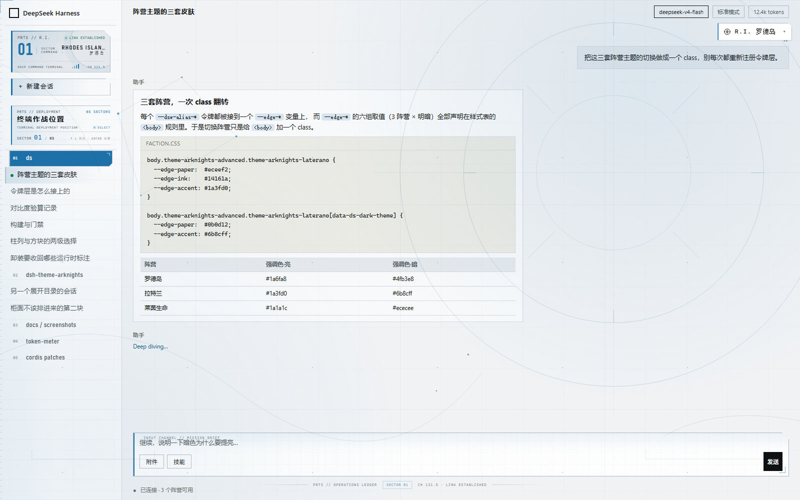
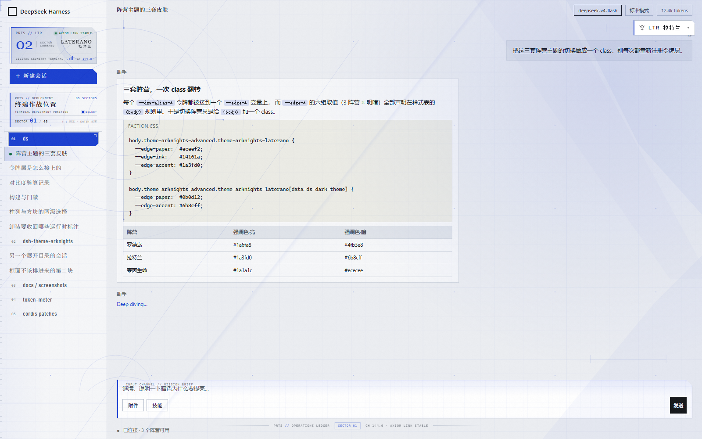
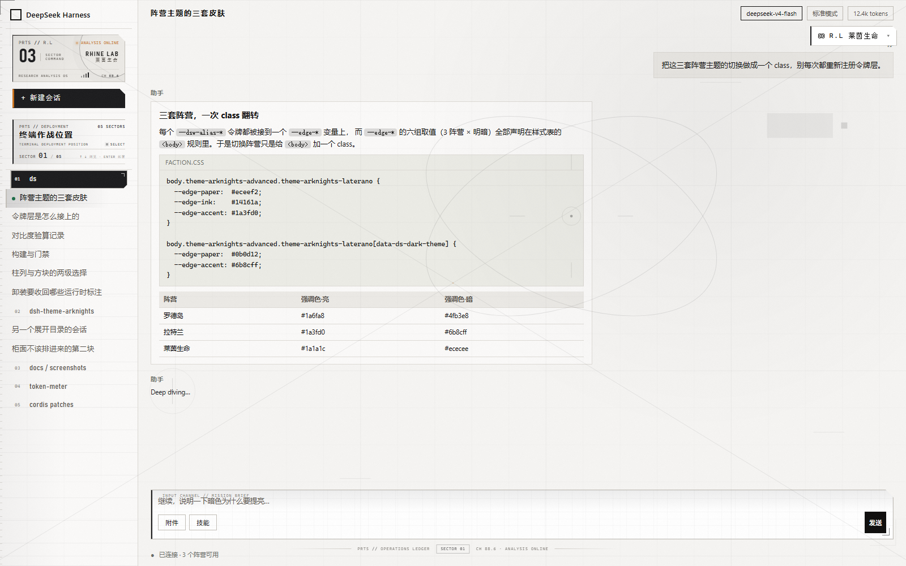
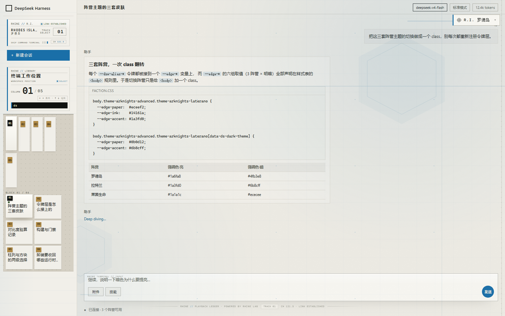
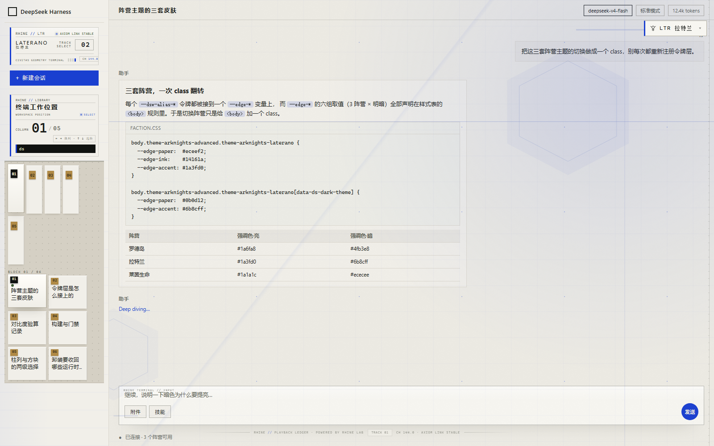
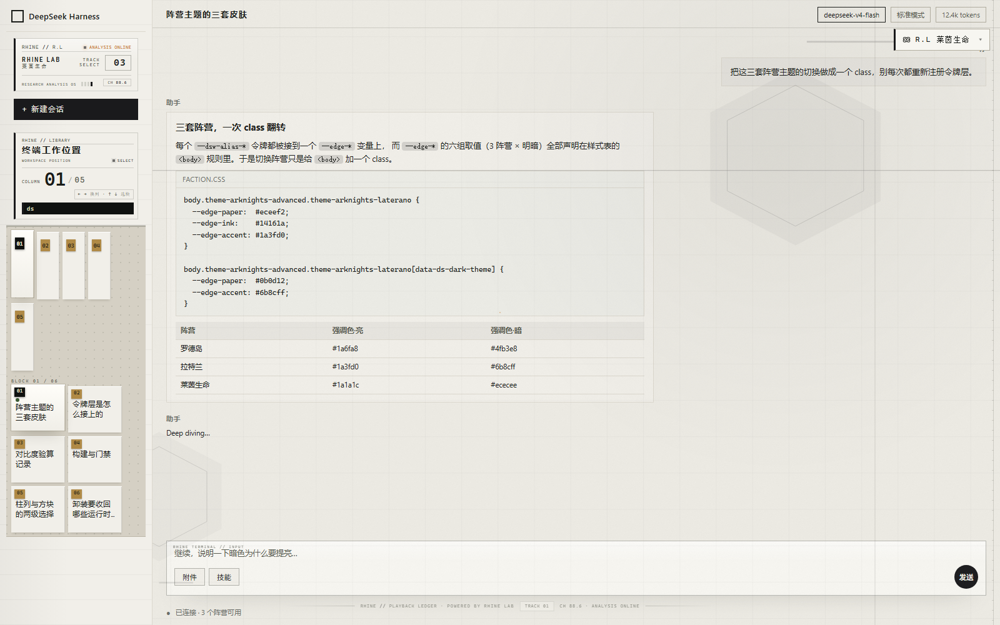
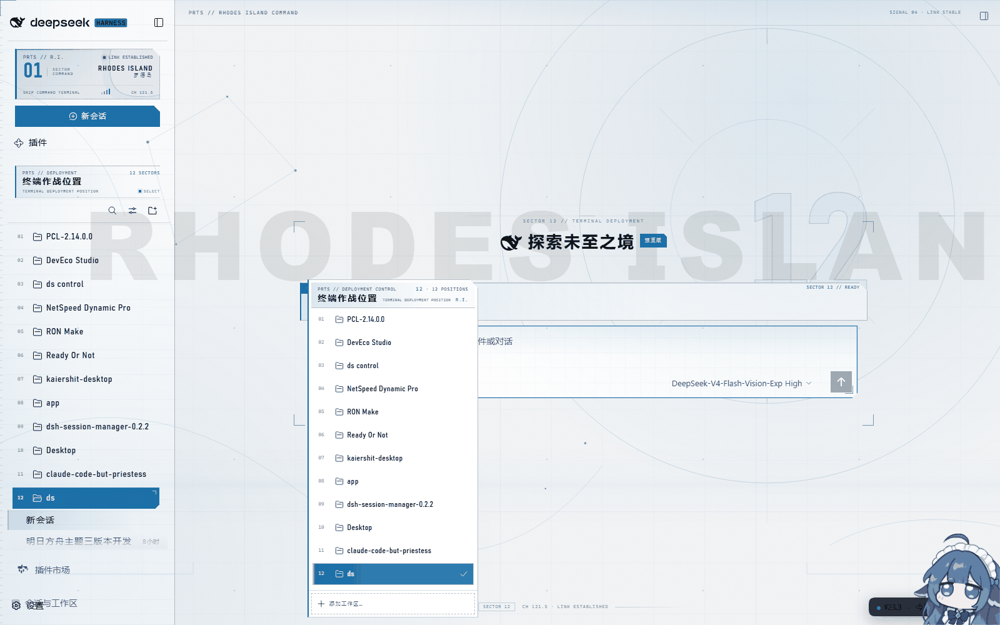
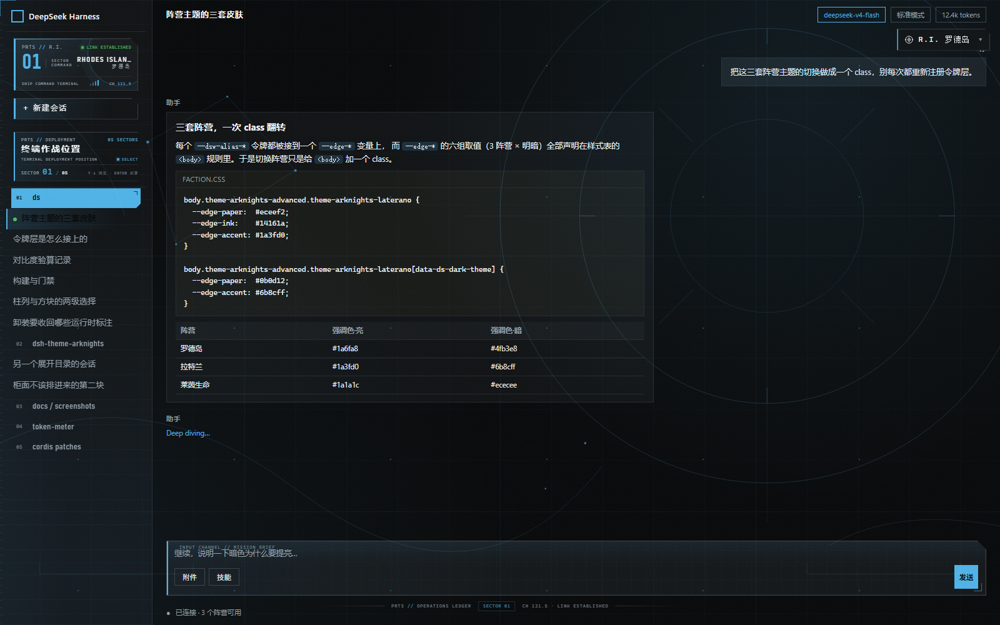
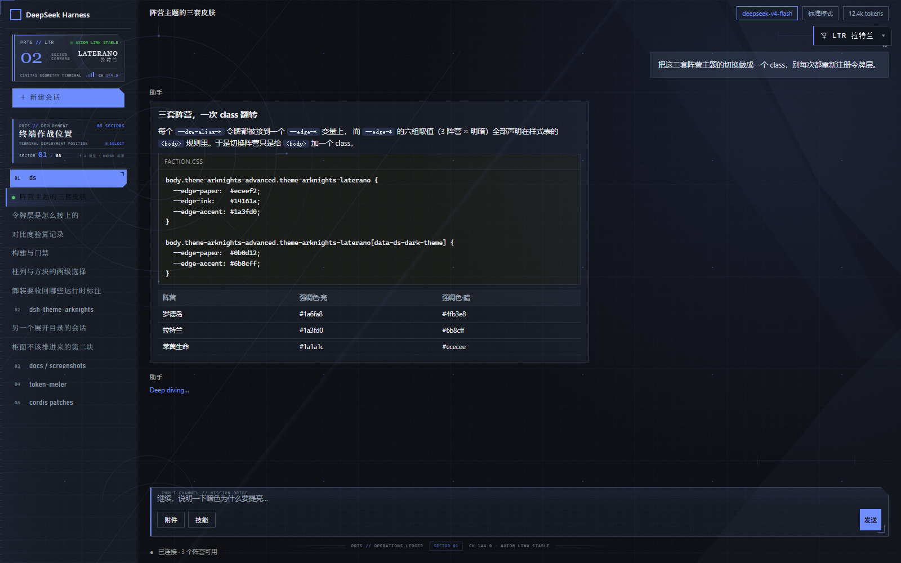
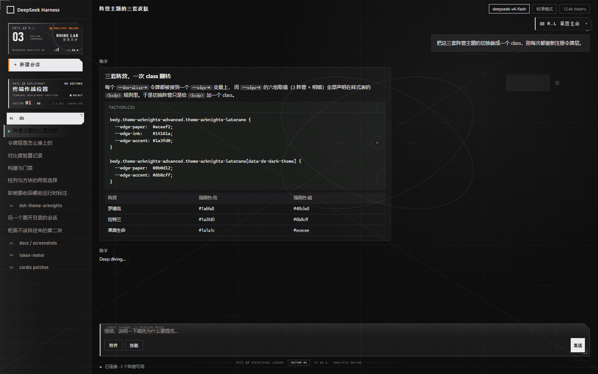

# dsh-theme-arknights

三套《明日方舟》阵营风格的 DSH Web 主题 —— **罗德岛**、**拉特兰**、**莱茵生命**。它不只替换颜色：进阶版把整个界面重排成一台作战终端，工作区列表就是**「终端作战位置」**，空状态的部署选择器、工作区菜单、输入区和顶栏都接入同一套 HUD 语言。

功能面（启动加载板、雷霆大字、余额胶囊、音频通知、输出滚动动画…）沿用 [dsh-theme-endfield](https://github.com/ymh0000123/dsh-theme-endfield) 的开关形状；视觉层、三阵营系统与终端界面层是本项目重写的。

- **Client 侧**（`client.js`）：令牌映射、三套阵营样式表、终端 DOM 层、快速切换器、设置页、全部视觉效果。
- **Host 侧**（`index.js`）：偏好持久化（DSH 设置表单 + profile 落盘）与音频通知播放。

| 进阶版 · 罗德岛 | 进阶版 · 拉特兰 | 进阶版 · 莱茵生命 |
| --- | --- | --- |
|  |  |  |
| **莱茵终端档 · 罗德岛** | **莱茵终端档 · 拉特兰** | **莱茵终端档 · 莱茵生命** |
|  |  |  |

上面六张由 `node test/shoot.js` 打在仿 DSH 骨架（`test/fixtures/preview.html`）上：同一份骨架、同一份注入的 `client.js`，只有阵营 class 与档位不同，所以横向对比读到的差异是真的。侧栏铭牌、扇区编号、部署面板与档位文案都在这批图里。下面这张是**真实 DSH 页面**：12 个工作区、扇区 12（`ds`）已部署，工作区菜单被画成部署控制面板，抬头与侧栏、页脚读同一个扇区号。



## 三档界面版本

设置里的 **界面版本** 一段切换器，三档共用同一套令牌与三套配色，区别在于重排到什么程度：

| 版本 | 做什么 | 适用 |
| --- | --- | --- |
| **进阶版**（默认） | 重排整体 UI：PRTS 铭牌、终端作战位置、扇区编号、部署选择面板、菜单抬头、任务简报输入区、顶栏频道、作战记录页脚、切角与 HUD 标注、三套阵营氛围层 | 想要完整明日方舟观感 |
| **莱茵终端版** | 叠在进阶版之上的**材质层 + 结构层**：侧栏改成一台**文件柜**——工作区是**一列列竖着的档案板**、会话是**横向一排短档案板**（两级选择各自带读数，柜面正上方钉当前工作区的铭牌），陶瓷白/墨黑纸面、列表按行条纹、数值右对齐 + 发丝线、直角为主、发送键是全屏唯一的圆形、输入区改成 transport 条、文案换成 `RHINE // LIBRARY` 与 `BLOCK`；取自 [Rhine-Music-Database](https://github.com/MikeQu223/Rhine-Music-Database) 的界面逻辑 | 想要参考项目那种「器材」而非「皮肤」的味道 |
| **通用适配** | 只换配色、标题字族、圆角与细节，界面骨架与应用原生完全一致 | 保守 / 上游改版后临时退避 |

进阶版的全部规则**只加装饰、不改布局骨架**：CSS 选择器失配时最坏结果是少一处装饰，不会破版。终端 DOM 层也只做标注与少量装饰节点，关闭主题或切到通用适配时会把注入节点、观察器和原生节点上的属性全部收回。

莱茵终端版不是第四套阵营：**阵营管颜色，档位管材质**。切到它，强调色、徽标、状态色仍然是阵营那一份真相（`--edge-accent` / `--signal` / `--status-*` 一律不覆盖），被接管的只有纸面家族、字体字距、几何语言与装饰密度；它复用进阶版注入的 DOM 钩子，所以 body 上同时挂 `theme-arknights-advanced` 与 `theme-arknights-lab`。陶瓷底 + 钢蓝（罗德岛）/ 电光蓝（拉特兰）/ 墨黑（莱茵生命）三种强调都验过对比度，其中莱茵生命那一套与参考项目几乎重合。

## 终端作战位置

这是进阶版的核心结构，也是「工作区选择」在明日方舟语境里的落点：

- 侧栏工作区列表上方是一块 **PRTS // DEPLOYMENT** 抬头，标题为「终端作战位置」，右侧显示实时扇区总数；列表每一行前面有 `01`、`02`… 的作战位置编号。DSH 的「未分组」会话桶不是工作区，不参与编号与计数。
- 当前真正被部署的工作区**整行填充强调色**并切角，扇区号、图标、标题同步反白。判定依据是空状态工作区选择器上显示的名字，而不是目录的展开状态——展开一个目录不等于部署了它。
- 空状态的工作区选择器被包进一块 **「终端作战位置 // TERMINAL DEPLOYMENT POSITION」** 面板，右上角读 `SECTOR xx // READY`；打开工作区菜单时，菜单顶部出现 **PRTS // DEPLOYMENT CONTROL**，列出 `xx POSITIONS`，每一项同样带扇区编号与选中态。
- 进入对话后，页脚收回、空状态部署面板消失，但侧栏的作战位置与顶栏频道仍在；对话页没有 hero 可读时，选中态回退到应用自身的结构信号，不会把当前会话对应的目录弄丢。
- 底部有一条只在空状态出现的 **PRTS // OPERATIONS LEDGER** 页脚，显示当前扇区、频道与链路状态。
- 切到**莱茵终端版**，词表先换：铭牌与抬头读 `RHINE // LIBRARY`、标题「终端工作位置」、编号 `TRACK 01`、页脚 `RHINE // PLAYBACK LEDGER · POWERED BY RHINE LAB`。词表在 `36-terminal-ui.js` 的 `TERMINAL_WORDS` 里按档位取，扫描时重写文本，不重建节点。然后结构也换，见下一节。

## 两级选择：档案立面 + 短档案板（莱茵终端版）

参考项目的选择器不是一张表，而是**上下两级**：上面一列列竖着的**档案板**选「组」，下面横向一排**短板**选「组里的第几个」——整块界面是一台**文件柜**。莱茵终端版把这套读法原样搬到 DSH 上，**工作区 = 档案板，会话 = 短档案板**：

- **第一级 · 档案立面**：工作区列表转成一片柜面（`--lab-cavity` 底 + 上沿导轨 + 一层几乎看不见的点阵），每块板 36×108 竖着排，排满一行再起一行（真页面 270px 侧栏一排六块）。板面是一整块平板，**没有斜面、没有拉手、没有纹理**——参考里只有一块平板和上部靠左的一枚暖色编号标签；当前那块被灯整块照亮（奶油纸白）并向前挪 3px，标签翻成黑底暖白字的黑牌。抬头上方是 `COLUMN 01 / 13` 大读数（数字永远比标签大、分母比分子小）与键位芯片 `← → 换列 · ↑ ↓ 选块`。
- **柜面铭牌与名字**：当前工作区的名字不写在 36px 的板面上，而是钉在柜面正上方那条整行宽的黑铭牌上，读 `▍DG-lab`——和参考里钉在亮板上的黑牌是同一件东西。铭牌是终端层注入的真实节点（`data-ak-part="plate"`），不是伪元素；进阶版常驻但隐藏。**其余板的名字在悬停时出现**：主题在每行写 `data-ak-name`，指针移到某块板上时在它旁边亮出一块同材质的黑牌（右侧放不下就翻到左边，上下夹回视口）。
- **点开一格 = 打开一个抽屉**：应用的侧栏点击只展开目录，不会把工作区设为当前部署。主题记住点过的那一格，把它点亮、把铭牌换成它，并只排这一组的会话；再点一次收起，当前板落回部署工作区。`aria-expanded` 不是选中信号——同时展开多个目录时也永远只有一块当前板。
- **第二级 · 短档案板**：会话行转成同一套材质的短板（86×74，标题两行截断，图标与操作键收起），块号压在左上角的标签上，柜面里读 `BLOCK 01 / 02`。当前那块同样被灯照亮、标签翻成黑牌。其余展开目录的会话留在 DOM 里，但不占柜面格位——柜面只排当前目录这一组，读数才对得上用户点开的那一格。
- 两级**共用同一个柜面**：容器不是从行往上取一层就算，而是继续往上找到「装下全部行」的那一层（`akCabinetField`），沿途的 per-item wrapper 全部摊成 `display: contents`；真页面上第一版只圈住第一组——第一块板 36px、其余 251px 铺满侧栏，就是这么炸的。
- 柜面自己纵向滚动（应用把列表高度钉死在侧栏里）：滚动条固定留 6px，一出现也不会把六列挤成五列；横向不滚，排满就换行。点开目录后**会话必须真的出现在柜面里**：塞得下就直接排；只有一行会话、柜面又矮时，会话块变成贴着柜面底部的托盘，并把当前板滚到托盘上方；会话有多行时退回把柜面滚到会话区。否则展开的会话会落在整面墙之后——矮窗口里柜面看起来一片空白，正是这个原因。
- **柜面里的原生件要重新排队**：应用的「展开其余 N 个会话」默认是整行按钮，会把墙面切成 6 + 1 + 6，现在压成会话末尾的一条窄操作带，且只显示当前目录那一条；会话行挂的悬停预览卡会落在侧栏左上角盖住抬头，lab 档把它收起，长标题改由原生 tooltip 兜底。
- 进阶版不受影响：它仍然是纵向清单，只是抬头多了同一块 `SECTOR 01 / 04` 读数与 `↑ ↓ 浏览 · ENTER 部署` 提示，两档读同一份真相。

## 三套阵营

三套的设计依据是三个二创/官方风格的参考（逐帧看过）：

| 阵营 | 参考 | 纸面（亮 / 暗） | 强调色（亮 / 暗） | 标题字族 | 氛围纹理 |
| --- | --- | --- | --- | --- | --- |
| **罗德岛**（默认） | [罗德岛个人通讯终端](https://www.bilibili.com/video/BV1JS4y1q7xJ) | 冷白 `#f2f4f6` / 近黑 `#08090a` | `#1a6fa8` / `#4fb3e8` | Barlow Condensed 窄字重无衬线 | 轨道圆环 + 节点拓扑 + 通讯弧线 + 精密网格 |
| **拉特兰** | [拉特兰数理风 PPT](https://www.bilibili.com/video/BV1B5GdzeE46) | 冷灰蓝图纸 `#eceef2` / 深蓝黑 `#0b0d12` | 皇家蓝 `#1a3fd0` / `#6b8cff` | Cormorant Garamond 衬线 | 浅蓝图纸 + 同心圆 + 坐标刻度 + 斜切碎片 |
| **莱茵生命** | [莱茵生命主题 PPT](https://www.bilibili.com/video/BV19Z4y187gi) | 暖白 `#f6f5f3` / 纯黑 `#0a0a0b` | 黑白 `#1a1a1c` / `#ececee`，信号橙 `#c9701a` / `#e8862a` | Inter 宽松字距无衬线 | 单色 ∞ 结构 + X 对角线 + 十字准星 + 极细分度 |

三套都**换的不只是颜色**：纹理几何、标题字族、字距、光晕强度、状态灯颜色、侧栏字标（`R.I. / 01`、`LTR / 02`、`R.L / 03`）与频道名（`CH 121.5` / `144.0` / `88.6`）都各自一套。版式骨架共用，所以切换时页面不跳动。

表里的「纸面」是进阶版的取值。切到莱茵终端版，三套纸面统一换成陶瓷 `#edebe4` / 墨黑 `#141613`，强调色、点缀色与徽标一律不变——这正是「阵营管颜色、档位管材质」那条分工的落点。

两点和直觉相反、但按参考纠正过来的地方：

- **拉特兰不是暖金圣城**，而是「理律与几何」：冷灰蓝图纸 + 饱和皇家蓝 + 圆形辅助线。它的参考明确是数理风。
- **莱茵生命不是荧光青绿**，而是**几乎无彩色**：黑白灰两个极端 + 宽松字距 + 十字准星，只留一点橙色（`--edge-signal`）作状态点缀。

| 罗德岛·暗色 | 拉特兰·暗色 | 莱茵生命·暗色 |
| --- | --- | --- |
|  |  |  |

背景纹理的写法是 **SVG 遮罩**：data URI 里只有形状（`mask-image`，只取 alpha），颜色来自 `background-color: var(--edge-accent)`。同一张形状在暗色下用 `screen`、亮色下用 `multiply`，所以三套阵营 × 明暗共用 3 份遮罩，不需要 6 张图，也没有下载任何位图素材。

## 快速切换：三个入口

| 入口 | 操作 |
| --- | --- |
| **设置页**：设置 › 明日方舟阵营主题 | 阵营行三个徽标按钮（底色是各自阵营的强调色），另有界面版本三选切换器 |
| **悬浮阵营条**：右上角常驻胶囊 | 点当前徽标展开三选 |
| **键盘** | `Ctrl/Cmd+Shift+1` / `2` / `3` 直选，`Ctrl/Cmd+Shift+K` 循环 |

三者写同一个偏好字段，所以任何一处切换都同步其余两处。键盘用 `Shift` 组合是为了不抢浏览器自己的 `Ctrl+1..9` 切标签页。

## 功能

开关集中在 **设置 › 明日方舟阵营主题**，共 29 个字段：

| 组 | 功能 |
| --- | --- |
| **01 主题** | 总开关、阵营（三选）、界面版本（三选：通用适配 / 进阶版 / 莱茵终端版）、圆角模式、磨砂玻璃 |
| **02 背景** | 背景水印、水印保持显示 |
| **03 动画** | 输出滚动动画（把流式输出的整段跳变摊成逐帧滑动，不改应用滚动位置）、动画强度、启动加载动画 |
| **04 娱乐** | 雷霆大字（任务开始/完成，3 秒自动消失，点击即关）、大字入场动画、顶部余额胶囊（DeepSeek 峰谷时段 / 渠道额度）、渠道额度读数、胶囊位置与防遮挡 |
| **05 音频** | 音频通知总开关（**默认关**，opt-in）、启动/开始/结束/需要回应/出错四个槽位、音量、防抖间隔、自定义音效目录、诊断日志 |

音频由**宿主进程**播放而不是浏览器：页面最小化、切到别的应用时同样能听到——那恰好是最需要提示的场合。

进阶版终端层没有单独的开关，跟随「界面版本」。除了这些开关，还有一批随主题自动生效的可读性修正（审批弹窗重绘为全屏白条、按钮对比度、预览徽标、顶栏模式胶囊、回合状态标签着色等），详见 [docs/design-language.md](docs/design-language.md)。

## 安装

```bash
dsh plugin --profile web add github:xtd1145/dsh-theme-arknights
```

重启或重新加载 `web` profile 后生效。

> **与 dsh-theme-endfield 互斥**：两套主题同时挂载会互相覆盖令牌层与样式表，视觉会混搭。请只启用其中一个。

### 手动安装（复制到 profile）

在 `<profile>/cordis.patch.yml` 追加一行（`id` 必须与 `index.js` 的 `SETTINGS_ENTRY`、`client.js` 的 `PREFS_ENTRY` 一致，`check.js` 会校验这三处）：

```yaml
- id: theme-arknights
  name: dsh-theme-arknights
```

> **必须复制整份目录，不能漏 `lib/`。** host 半在顶层 `require('./lib/audio.js')`，缺了它 DSH 只会
> 打印一行 `theme-arknights (dsh-theme-arknights): failed to import`，界面上表现为「主题没生效」，
> 很容易误判成样式问题。
>
> 特别注意：PowerShell 的 `Copy-Item -Path 'src\*' -Destination dest -Recurse -Exclude @('node_modules')`
> **会静默漏掉部分顶层目录**（实测漏了 `lib/`、`scripts/`、`sounds/`、`src/`，而 `locale/`、`docs/` 却复制过去了）。
> 用 robocopy 更可靠，装完顺手验一下 host 半能否加载：
>
> ```powershell
> robocopy <repo> <profile>\node_modules\dsh-theme-arknights /E /XD node_modules .git
> node -e "console.log(require('<profile>/node_modules/dsh-theme-arknights').Config !== undefined)"
> ```

### 更新插件文件时的加载时机

| 改动 | 生效方式 |
| --- | --- |
| Client 半 `client.js` | Host 按请求从磁盘读取，浏览器刷新即可 |
| Host 半 `index.js` | 只在 profile 启动时 import 一次，**必须整进程重启 DSH** |

### 设置总是「刷新后复位」

先看 Host 侧有没有这份 `Config`（`require('./index.js').Config` 不是 `undefined`）。没有 Config 时 DSH 不投影表单，所有开关只在页面内生效。排查顺序：

1. `index.js` 是否导出 `Config`，且 36 个字段是否都带 `.volatile()`
2. Host 日志里有没有 `Config built from …（volatile mode: native/synthesized）`
3. 设置页是否出现（没有 slots 服务时会安静跳过，但悬浮条与快捷键仍可用）

## 开发与验证

```bash
node scripts/build.js        # 由 src/ 拼出 index.js + client.js
npm run check                # 产物是否过期 + 静态契约校验（49 项）
npm test                     # 构建校验 + 契约 + 对比度（194 项断言）
npm run shots                # 用 fixture 页面截三套阵营（需本机 Edge/Chrome）
npm run verify -- <url>      # 在**真实 dsh web 页面**上验证并截图
```

| 验证 | 覆盖什么 |
| --- | --- |
| `check.js` | 两侧字段表逐字段一致、六组阵营变量完整、被引用的 `--edge-*` 全部有归属、**选择器锚点必须是应用里真实存在的 localName**、两档词表键集一致、柜面容器/摊平层/块标记/铭牌槽两侧成对存在、十四个柜体与亮板令牌亮暗各一套、lab 层不许出现横向滚动且必须恰好一处 `row wrap`、命名空间三处一致、样式表可安全嵌入模板字面量 |
| `test/palette-contrast.test.js` | 六组配色 × 每个角色的 WCAG 对比度（正文 AAA、其余 AA、装饰另有一套区间） |
| `test/shoot.js` | 在浏览器里注入 client.js 到 fixture，逐个阵营 × 档位截图并断言 class 翻转、`--edge-accent` 解析、令牌层是否跟着阵营走、悬浮条三选；再加一组**几何断言**：柜面容器真的横排换行、档案板竖长、短档案板横长、读数是 `01/05` 这种两位比、键位提示按档位换词；lab 档另看静默失效——柜面铭牌有没有字、铭牌与标签牌的文字对底色是否到 4.5:1、柜面是否被撑出横向溢出；选中态另有一组现场回归：每块板都有 `data-ak-name`、同时展开多组时只有一块当前板、铭牌跟着当前板、别的目录的会话不占柜面 |
| `test/verify-real.js` | 打开**真实的 dsh web 页面**（插件由 DSH 自己挂载），断言：`/plugins/dsh-theme-arknights/client.js` 进入 combo、样式表注入、body class、强调色、令牌层、悬浮条；再逐个阵营派发 `Ctrl+Shift+1/2/3` 并截图；lab 档把视口锁到 **1366×768**（用户报「点开目录后柜面空白」的尺寸），核对柜面几何、每块板的名字、唯一当前板与铭牌，并用真实鼠标逐个点击折叠目录直到找到有会话的那一个：它必须成为唯一当前板、只排该组会话、**会话块落进柜面视口**（单行托盘时当前板仍可见），再点一次回到部署工作区 |

### 关于「锚点必须是真实 localName」

这一条检查是踩出来的：进阶版第一版用了 `_transcript` / `_bubble` / `_role` /
`_sectionTitle` / `_groupLabel` / `_primaryButton` 这些**应用里并不存在**的类名
（还把输入区的 class 误写成了 `data-composer-seat` 属性）。它们不会报错，只是规则
永不命中——界面上表现为「装饰没生效」，肉眼查不出来。

`check.js` 现在用 dsh-theme-endfield 在同一版 DSH 上验证过的 localName 做白名单
（`_frame` / `_header` / `_centerCol` / `_sidebarCol` / `_rightbarCol` /
`_composerSeat` / `_card` / `_sessionRow` …），写了白名单外的名字直接构建失败。

## 项目结构

```text
src/client/        Client 侧源码片段（拼接顺序见 src/client/manifest.js）
  36-terminal-ui.js        进阶版终端 DOM 层（铭牌/作战位置/页脚/菜单抬头，含按档位切换的文案表）
src/host/          Host 侧源码片段（拼接顺序见 src/host/manifest.js）
src/styles/theme.css     功能样式（玻璃、加载屏、大字、胶囊、审批弹窗重绘…）
src/styles/faction.css   三阵营变量组 + 明日方舟氛围层 + 进阶版终端排版层
src/styles/lab.css       第三档「莱茵终端版」材质 + 结构层（工作区档案立面、会话短档案板、柜面铭牌、陶瓷纸面、条纹行、右对齐数值、transport 输入条）
client.js / index.js      发布产物，由 scripts/build.js 拼出（不要直接编辑）
lib/               音频通知：槽位定义、WAV 合成与播放运行时
sounds/            生成的通知音
scripts/           构建：lib/bundle.js 拼接器 + 各入口
test/              对比度测试、浏览器截图验证、fixture
docs/              设计文档与截图
cordis.patch.yml   Bundle 注入配置
```

## 技术要点

**换阵营只是一个 class 翻转。** 令牌层（`41-mount-tokens.js`）把每个 `--dsw-alias-*` 覆盖成 `var(--edge-*)`，而 `--edge-*` 的六组取值（3 阵营 × 明暗）声明在 `faction.css` 的 `<body>` 规则里。因为应用是把令牌写成 `<body>` 行内样式的，行内 `var()` 会引用同元素上由样式表声明的自定义属性——于是切阵营不重新注册令牌层、不重算应用样式、无 JS 重绘。

**终端层是幂等的 DOM 标注。** 工作区菜单是 portaled 的，侧栏会被应用反复重渲染，工作区数量与选中项都是运行时数据，伪元素拿不到。`36-terminal-ui.js` 只观察会改变终端结构的区域（侧栏、空状态输入区、打开中的菜单），排除流式消息 DOM；所有扫描可重复执行，节点带 `data-ak-tui` 标记，关主题或切通用适配时全部收回。铭牌、抬头、菜单抬头只更新文本与属性，不重建节点。

**「已部署」不是「已展开」，点开的那一格也不是「已部署」。** 侧栏行的 `aria-expanded` 只代表目录展开，应用允许同时展开多个目录；直接拿它当选中态，整面柜墙会一起翻成奶油色。选中态以空状态选择器显示的**工作区名**与行标题比对为准；对话页没有空状态时，才回退到应用自身的选中信号。用户在柜面上点过某一格时，这一格临时成为当前板（点亮、换铭牌、只排它这一组会话），再点一次收起并落回部署工作区；展开时只把**会话**带进视口（托盘或滚到会话区），当前板始终留在柜面里。

**背景全部由代码生成。** 三张 SVG 遮罩只提供 alpha 形状，颜色读 `--edge-accent`；点阵、光晕与纸张颗粒由 CSS 渐变 / 内联噪声 SVG 承担。切阵营、切明暗、改强调色都会自动跟随，没有外部位图，也不需要为 6 种组合准备 6 份素材。

**大量边界处理**：输出滚动动画不改 `scrollTop`（跟随不中断）、加载板的双时钟驱动与硬性保险丝、大字用捕获阶段 `pointerdown` 关掉（不吃掉用户真正想点的那一下）、所有动效尊重 `prefers-reduced-motion`。

## 素材归属

本插件是**非官方同人作品**，与鹰角网络（Hypergryph）不存在任何隶属、赞助或背书关系。

- 《明日方舟》（Arknights）的游戏名称、阵营设定、标识、商标及相关美术素材，版权归**鹰角网络（上海鹰角网络科技有限公司，Hypergryph Network Technology）**所有。
- 本仓库**不包含任何游戏原始素材，也没有下载外部背景图片**：三套阵营的配色、纹理、字标与终端界面都是按阵营性格重新绘制的 CSS / 内联 SVG。
- 视觉参考：[罗德岛个人通讯终端](https://www.bilibili.com/video/BV1JS4y1q7xJ)、[拉特兰数理风 PPT](https://www.bilibili.com/video/BV1B5GdzeE46)、[莱茵生命主题 PPT](https://www.bilibili.com/video/BV19Z4y187gi)。
- 功能实现参考了 [dsh-theme-endfield](https://github.com/ymh0000123/dsh-theme-endfield)（MIT），视觉层为本项目重写。
- 本项目原创代码以 MIT 许可证发布。若权利方认为任何内容使用不当，请通过 Issue 联系，会立即删除或替换。

## 许可证

MIT，仅覆盖本项目的原创代码；第三方素材的归属见[素材归属](#素材归属)。
